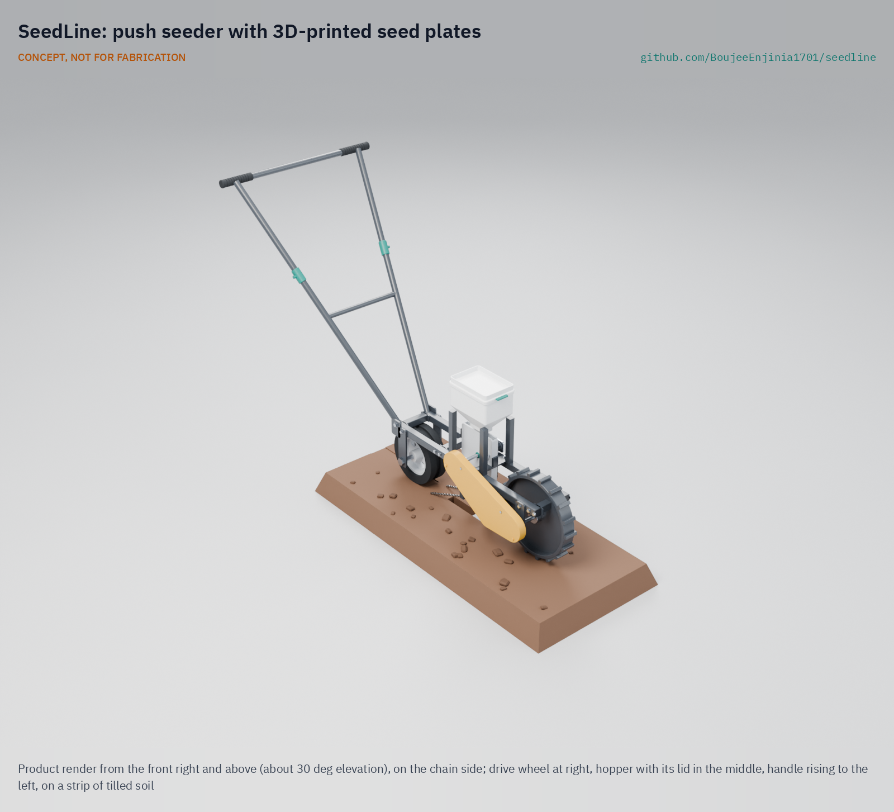
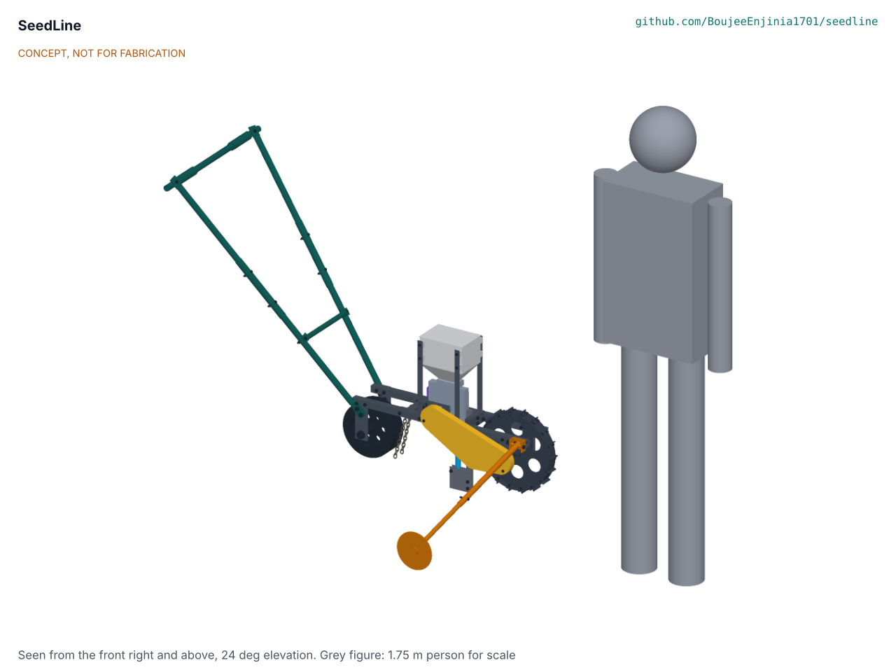
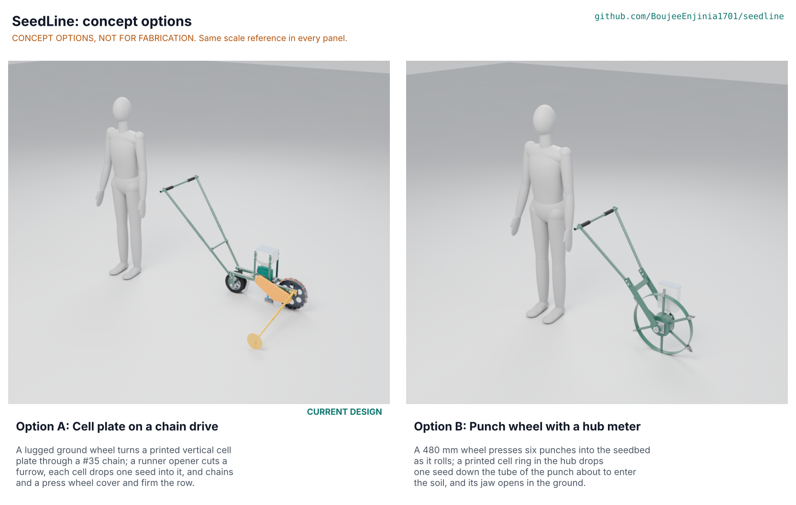
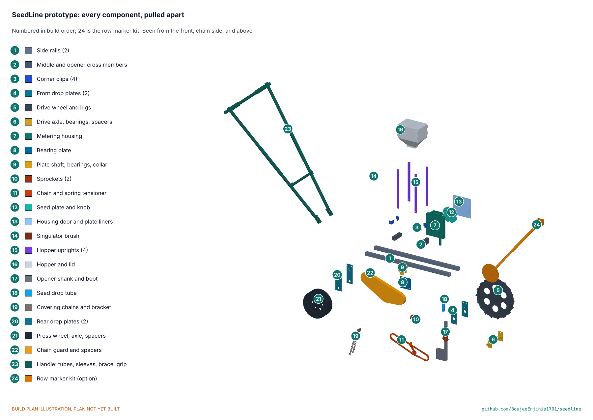

# SeedLine

    [](https://zenodo.org/badge/latestdoi/1386352405) [](https://github.com/BoujeeEnjinia1701/seedline/actions/workflows/reuse.yml) [](https://archive.softwareheritage.org/browse/origin/?origin_url=https://github.com/BoujeeEnjinia1701/seedline)

**Area:** Agriculture · **TRL:** 3 of 9 (proof of concept on paper) · **Value-engineering target:** USD 400; parts USD 266 with both kits · **Difficulty:** 2 of 5

Push seeder whose metering plates are 3D printed per crop and driven by the ground wheel, with an optional row-spacing kit.



[Exploded render](media/render-exploded.png) · [Detail render](media/render-detail.png) · [Interactive 3D model](media/viewer.html) · [Concept blueprint (PDF)](media/concept-blueprint.pdf) · [General arrangement SDL-DWG-001 (PDF)](cad/drawings/SDL-DWG-001.pdf) · [STEM check SDL-STM-001](docs/01b-stem-check.md) · [Concept options SDL-OPT-001](docs/02a-concept-options.md) · [Requirements SDL-URS-001 and SDL-PRS-001](docs/03-requirements.md) · [Traceability SDL-RTM-001](docs/03b-traceability.md) · [Calculations SDL-CAL-001](docs/04-calcs/01-sizing.md) · [Prototype build plan](docs/05-build-plan.md) · [Design decisions](docs/06-design-decisions.md) · [Review note](docs/REVIEW.md)

## Concept rationale

Seed spacing on a push seeder should depend on distance travelled, not on how fast or unevenly the operator walks, so SeedLine drives its metering plate from a lugged ground wheel through a roller chain. The metering plate is the part that has to match each crop and seed size, and it is the part farmers usually cannot get: stock plates are sold by the maker for a few common crops. Making that one part a flat 3D print, sized by a parametric function from the seed's dimensions, turns crop coverage into a file rather than a spare-parts order.

Everything else is deliberately ordinary: square steel tube bolted with a drill and spanners, #35 roller chain and sprockets, trolley wheels and bearings found in regional towns. An open design lets a cooperative, an agro-dealer or a local workshop build, repair and adapt the seeder, and print plates for local varieties, without depending on an importer.

## Burning platform

Most of the world's farms are small: about 84 % of the more than 570 million farms worldwide are under 2 ha ([Lowder, Skoet and Raney, *World Development*, 2016](https://www.sciencedirect.com/science/article/pii/S0305750X15002703); [Our World in Data](https://ourworldindata.org/smallholder-food-production)), and in India the average operational holding fell to 1.08 ha in 2015 to 2016, with 68 % of holdings under 1 ha ([Agriculture Census 2015-16, Government of India](https://www.fao.org/fileadmin/templates/ess/ess_test_folder/World_Census_Agriculture/WCA_2020/WCA_2020_new_doc/IND_REP_ENG_2015_2016.pdf)). On such plots seed is still sown by hand, and hoe planting has been estimated at about 56 h per hectare for one worker in southern Africa (Baudron et al., cited in a [CSBE jab planter study](https://library.csbe-scgab.ca/docs/meetings/2010/CSBE101037.pdf)), squeezed into the short planting window after the first rains.

Uneven hand placement also costs yield. Purdue University trials on maize found a loss of about 2.2 to 2.5 bu/acre (about 140 to 160 kg/ha) for each inch (25 mm) increase in the standard deviation of plant-to-plant spacing ([Nielsen, Purdue University](https://www.agry.purdue.edu/ext/corn/research/psv/update2004.html)). Singulating push seeders that fix this cost about $499 before rollers, while low-cost plate seeders drop several seeds per cell ([University of Minnesota Extension](https://blog-fruit-vegetable-ipm.extension.umn.edu/2024/11/lower-cost-equipment-for-seeding-and.html)).

## Where it could be used

### By industry

| Industry | Use |
| --- | --- |
| Smallholder field-crop farming | Row planting of maize, beans, sorghum and groundnut at set spacing on 0.2 to 2 ha plots |
| Market gardening and urban farming | Vegetable beds sown with pelleted seed plates, cutting thinning labor |
| Agricultural extension and NGOs | Demonstration plots and conservation agriculture programs that promote row planting |
| Seed companies and agro-dealers | Printing plates matched to the varieties they sell; renting seeders to customers |
| Agricultural research and education | Spacing and population trials, and teaching metering design with printable plates |
| Community workshops and maker spaces | Local build, repair and plate printing as a service |

### By country or region

| Country or region | Why it matters there |
| --- | --- |
| Zambia and southern Africa | Conservation farming lays out hand-hoe planting basins in a precise grid of 15,850 per hectare and plants with the first rains ([Haggblade and Tembo, IFPRI, 2003](https://cgspace.cgiar.org/items/90eae4be-ba6d-448a-8d95-77e7a87ad25c)); hoe planting takes about 56 h per hectare for one worker ([CSBE jab planter study](https://library.csbe-scgab.ca/docs/meetings/2010/CSBE101037.pdf)) |
| India | Average holding of 1.08 ha, with 68 % of holdings under 1 ha ([Agriculture Census 2015-16](https://www.fao.org/fileadmin/templates/ess/ess_test_folder/World_Census_Agriculture/WCA_2020/WCA_2020_new_doc/IND_REP_ENG_2015_2016.pdf)), too small for tractor planters |
| Ethiopia and Tanzania | Small family farms average 0.8 ha in Ethiopia, where maize and sorghum are staples and only 3.7 % of smallholders have access to machinery ([FAO country factsheet, Ethiopia](https://www.fao.org/3/I8911EN/i8911en.pdf)); in Tanzania maize is the main staple and 1.4 % of smallholder households use motorized equipment ([FAO country factsheet, Tanzania](https://www.fao.org/3/I8356EN/i8356en.pdf)) |
| Guatemala | Small family farms make up 82 % of farms and average 0.6 ha, and mountains bound the cultivable area ([FAO country factsheet, Guatemala](https://www.fao.org/3/I8357EN/i8357en.pdf)); plots this small suit a push seeder rather than a tractor planter |
| United States and Canada | Market gardens that choose between a $187 plate seeder and a $499 roller seeder ([UMN Extension](https://blog-fruit-vegetable-ipm.extension.umn.edu/2024/11/lower-cost-equipment-for-seeding-and.html)); a printable plate fills the gap |

## What sparked the idea

The starting point was Jethro Tull's horse-drawn seed drill of about 1701, which replaced broadcast sowing with a rotating cylinder whose cut grooves carried seed from a hopper down to a funnel and into the furrow, where it was covered ([ASME](https://www.asme.org/topics-resources/content/jethro-tull)). The grooves were cut into the axle beneath the hoppers, so seed dropped at even intervals as the drill moved forward and sowed three regular rows; Tull described the machine in *Horse-Hoeing Husbandry*, first published in 1731 ([Science Museum Group, model of Tull's drill](https://collection.sciencemuseumgroup.org.uk/objects/co39077/1-4-scale-model-of-jethro-tulls-seed-drill); [Science Museum Group, Jethro Tull](https://collection.sciencemuseumgroup.org.uk/people/cp37700/jethro-tull)). SeedLine borrows that principle, seed carried in cells on a part turned by the machine's own travel, and changes who can make the metering part: the cells are cut into a flat plate that anyone with a desktop printer can produce for their own seed, three centuries after Tull cut his by hand.

## Problem

Hand-seeding is slow and uneven, and precision planters are too costly for small plots.

## Concept

A single-row push seeder for smallholder field crops first, with vegetable plates to follow. A 300 mm lugged ground wheel drives an upright, 3D-printed seed plate through a #35 roller chain, so seed spacing follows distance travelled rather than walking speed. A runner opener cuts the furrow, drag chains cover the seed and a press wheel firms it. Swapping the printed plate (1 to 36 cells, including skip-cell plates for long spacings) sets in-row spacing; the base seeder runs a 15 T wheel sprocket (26 to 471 mm), and an optional ratio kit with 12 and 18 T sprockets extends the range to 22 to 589 mm. Seed under 2 mm is sown pelleted. The operator walks at about 2.9 km/h so the plate cells fill. A marker arm sets the next row at 200 to 900 mm. The frame bolts together from 25 mm square tube, with a 22 mm tube handle.

TRL 3 calculations (SDL-CAL-001 v0.6, on the constructable design of SDL-DDR-003 with the decisions of 2026-10-02 and the kit 1.9 fixes): 0.142 ha/h for maize on 0.75 m rows, about 132 N horizontal push in the design case, 14.2 kg (14.8 kg with the marker kit, every fastener weighed from the detailed model) and an estimated USD 224.10 in parts for the base seeder (USD 266.10 with the marker and ratio kits, USD 133.90 under the USD 400 value-engineering target). Mass meets its target with a small margin; placement quality and push effort on heavy seedbeds remain at risk.



Full design precis: [docs/02-concept.md](docs/02-concept.md)

## STEM check

Thirty-seven claims are checked (SDL-STM-001): 28 are within known science and 9 are plausible, and none fails. The check stays open on the nine plausible rows, which need a bench test, a print, weighing, an ergonomic assessment or a field trial: whether the printed cells fill at the walking-speed rule, the spacing uniformity that rests on assumed miss and double rates, the design-case push and whether one operator can sustain it for a planting day, the mass margin, plate print time and accuracy, and option B's seed timing and jaw opening. The detailed kit 1.9 model found four fit details that failed (the door screws stood over the housing's opening, the hub cross bolt sat in the wheel's web, the tensioner pivot nut sat in the chain, the hopper insert holes were too small) and, once every fastener was weighed, a mass over 15 kg, and the independent review found a plate print time over 2 h; each was fixed under Amish's standing instruction of 2026-10-23 (SDL-DEC-001 F1 to F8).

## Concept options



Option A, the current design (a cell plate on a chain drive), scores 169 of 230 against 131 for option B, a punch wheel that presses six punches into the seedbed and meters seed in its hub; option A is recommended, Proposed, awaiting Amish (SDL-OPT-001, SDL-DDR-004). Both are modelled to the same detail level (detail level D3) in [cad/src/model.py](cad/src/model.py).

## Key components

- 300 mm lugged ground drive wheel
- #35 chain drive with a 15 T wheel sprocket, a spring tensioner and a chain guard; 12 and 18 T sprockets in an optional ratio kit
- 2.4 L seed hopper and metering housing
- 3D-printed PETG seed plates, one per crop and spacing, with a singulator brush
- Furrow opener (shank and boot) with six depth settings, and covering chains
- 200 mm concave press wheel
- Bolted steel frame (25 mm square tube, 3 mm plates) and telescoping 22 x 1.2 mm tube handle
- Row marker arm in aluminium tube (optional row-spacing kit)
- About 350 ISO bolts, nuts, washers, screws, pins and inserts, every one in the model

The priced bill of materials is in [bom/bom.csv](bom/bom.csv). The parametric model is [cad/src/model.py](cad/src/model.py) (kit 1.9, detail level D3, checked by `python .kit/cad_check.py`), with STEP per part and per assembly in `cad/step/` and STL in `cad/stl/`.

## Building the prototype

The prototype build plan ([docs/05-build-plan.md](docs/05-build-plan.md), SDL-BLD-001) takes a capable maker through the first proof-of-concept seeder component by component, with a making sketch for each made part, close-ups of the joints and a picture for every assembly step. Everything is cut, drilled, tapped, bent or printed and then bolted together; nothing is welded. Making the concept buildable changed some details (an opener cross member behind the drive wheel, a chain-side shaft support, a hopper collar and uprights, a spring tensioner inside a fixed guard), recorded in SDL-DDR-003 and accepted by Amish on 2026-10-02; the kit 1.9 detailed model added seven fit and mass fixes and a print setting (SDL-DEC-001 F1 to F8). It is a plan, not yet built: building and testing to it is TRL 4 work.



## Safety

> **Safety:** The chain drive turns whenever the wheel turns and has nip points; keep the guard fitted and hold the wheel still for plate changes and cleaning. The opener and wheel lugs are sharp. Seed treated with pesticides is toxic: follow the seed label, wear gloves and never reuse the hopper for food. See the safety section of [docs/02-concept.md](docs/02-concept.md).

## Repository layout

```
docs/                 controlled documents (PRB, STM, OPT, PRC, URS, PRS, RTM, CAL, BLD, DEC, REG, FEA, RSK, MKT, PLN, DDR) and REVIEW.md
docs/04-calcs/        sizing.py (SDL-CAL-001) and stem_check.py (SDL-STM-001)
cad/src/model.py      parametric model of options A and B (kit 1.9, detail level D3); option B in punch_wheel.py
cad/src/              sheets.py, build_plan_media.py, concept_media.py, product_model.py, sdl_parts.py
cad/step/, cad/stl/   STEP per part of the chosen design and per assembly for each option; STL of the chosen design
cad/drawings/         SDL-DWG-001 general arrangement and SDL-DWG-101 to 124 making sketches
bom/bom.csv           priced bill of materials
media/                concept media and renders
.kit/                 shared documentation kit 1.9.1 (do not edit here)
```

## Documentation

Controlled documents follow the portfolio [documentation standard](.kit/STANDARDS.md). Each carries a document ID (SDL-PRC-001 for the precis), a version and a revision history. Run `python .kit/render.py --check` to validate them, `python .kit/cad_check.py --export` for the CAD fidelity check, `python docs/04-calcs/sizing.py` for the calculations and `python .kit/trace.py` for the traceability matrix. Branded PDFs are built with `python .kit/render.py` and attached to GitHub Releases when a document is tagged, for example `SDL-PRC-001/v1.0`.

## Credits

Designed by Amish Chadha. See [CONTRIBUTORS.md](CONTRIBUTORS.md) for roles. To cite this design, use [CITATION.cff](CITATION.cff) (GitHub shows it as "Cite this repository").

AI assistance (Claude) was used to accelerate concept renders, prototype documentation and first-pass sizing calculations. Design direction and all decisions are Amish Chadha's, recorded in this repository's decision records (`docs/decisions/`).

## Licenses

- **Hardware** (CAD, drawings, BOM, electronics): [CERN-OHL-S v2](LICENSE)
- **Software** (firmware, scripts, notebooks): [MIT](LICENSE-SOFTWARE)

A project of the [Design Molecule](https://designmolecule.com) lab.
